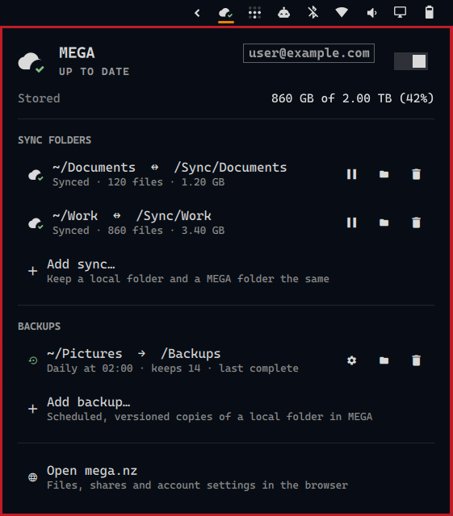

# omarchy-megacmd

MEGA in the [Omarchy](https://omarchy.org) bar: sync folders, backups,
storage and transfers, driven by [MEGAcmd](https://github.com/meganz/MEGAcmd)
instead of the MEGAsync desktop app.

- A cloud icon in the bar with a coloured badge for the overall state:
  up to date, syncing, paused, storage nearly full, an error, or logged out.
  Badge colours come from the current Omarchy theme.
- A panel to pause, resume, add and remove sync folders and scheduled,
  versioned backups, with storage use and transfer progress.
- A desktop notification once per problem: a sync error, a failed backup,
  being logged out, the MEGAcmd engine stopping, and storage use crossing 90%
  and 95%. Notifications name no folder; clicking one opens the panel, which
  shows it.
- The widget never starts the MEGAcmd engine by itself. When the engine is
  stopped it says so, and "Start MEGAcmd" in the panel starts it again.



## Requirements

- Omarchy with its Quickshell bar (`omarchy-shell`).
- MEGAcmd. On Arch Linux it comes from MEGA's own signed repository; see
  [MEGA's Linux downloads](https://mega.io/cmd#download). The package is
  `megacmd`.
- `python3`, `gum`, `pgrep` and a Nerd Font, which Omarchy already provides.

## Installation

1. Run the MEGAcmd engine from login, so syncs and backups run without a
   window:

   ```sh
   cp systemd/mega-cmd-server.service ~/.config/systemd/user/
   systemctl --user enable --now mega-cmd-server.service
   ```

2. Add the plugin to the bar:

   ```sh
   omarchy plugin add https://github.com/yardquit/omarchy-megacmd --enable
   ```

3. Click the cloud icon and choose **Log in to MEGA**. A terminal opens
   MEGAcmd's own shell, which asks for the password and 2FA code itself, so
   the password never appears in a command line. The session is kept, so this
   is needed only once.

If MEGAsync is installed, quit it before adding the same folders here: two
programs syncing one folder produce conflicting copies.

## Removal

```sh
omarchy plugin remove yardquit.mega
systemctl --user disable --now mega-cmd-server.service
rm ~/.config/systemd/user/mega-cmd-server.service
```

Removing the widget leaves MEGAcmd's syncs and backups as they are; stopping
the engine pauses them until it runs again. Remove them in the panel first to
stop them for good.

## Use

| In the bar | Does |
|---|---|
| Left click | Open the panel |
| Right click | Pause or resume all syncing |
| Middle click | Refresh |

In the panel, the arrow keys move between rows and Enter runs a row's main
action (pause or resume a sync, change a backup's settings, add a sync or
backup). `o` opens the selected folder, `s` changes the selected backup's
schedule and versions, `x` pressed twice removes the selected sync or backup
(its files stay where they are), `p` pauses or resumes all syncing, `r`
refreshes, and Escape closes the panel.

**Add sync…** and **Add backup…** open a short guided dialog in a terminal:
pick the local folder, confirm or change the suggested MEGA folder and, for a
backup, choose the schedule and how many backups to keep. Each backup is a
dated copy named `<folder>_bk_<time>` inside the chosen MEGA folder. A
backup's settings button (or `s`) changes its schedule and the number kept,
offering the current values first; backups already made stay as they are.

## Settings

Set these on the widget's entry in `~/.config/omarchy/shell.json`:

```json
{ "id": "yardquit.mega", "syncFolder": "/Sync", "backupFolder": "/Backups" }
```

| Setting | Default | Meaning |
|---|---|---|
| `syncFolder` | `/` | MEGA folder suggested as the parent of a new sync |
| `backupFolder` | `/Backups` | MEGA folder suggested for new backups |
| `refreshIntervalSec` | `60` | How often to check MEGAcmd while the panel is closed (every 3 seconds while it is open) |

## Commands

The widget answers `omarchy-shell yardquit.mega <command>`:

| Command | Does |
|---|---|
| `open`, `close`, `toggle` | Show or hide the panel |
| `refresh` | Check MEGAcmd now |
| `status` | Print the overall state |
| `preview <state>` | Show a saved state from `fixtures/` instead of the live one |
| `live` | Return to the live state |

The saved states are `ok`, `syncing`, `paused`, `sync-error`,
`backup-failed`, `storage-90`, `storage-95`, `logged-out` and `stopped`.
Previews also send their notifications, marked "(preview)". While a preview
is shown, the panel's actions do nothing, as its syncs and backups are only
examples.

## Privacy

Other accounts on the same computer can see the command lines of running
programs. The widget's regular status check passes no folder names, and its
notifications name none. Folder paths do appear in command lines when you act
yourself: opening a folder starts the file manager with its path, and adding
or changing a sync or backup runs MEGAcmd's commands, which take the paths as
arguments, in a terminal that also shows the suggested MEGA folder.

## Development

Clone the repository and link it into Omarchy's plugin folder:

```sh
git clone https://github.com/yardquit/omarchy-megacmd
ln -s "$PWD/omarchy-megacmd" ~/.config/omarchy/plugins/yardquit.mega
omarchy plugin enable yardquit.mega
```

After changing QML files, run `omarchy restart shell`; the bar's automatic
reload can keep running the previous version.

Run the tests with:

```sh
python3 -m unittest discover -s tests
```

| File | Purpose |
|---|---|
| `status.py` | Collects MEGAcmd's state and prints it as JSON |
| `Service.qml` | The plugin's service, loaded once: polls `status.py`, runs actions, sends notifications |
| `Panel.qml` | Bar button and panel, one per bar, all showing the service's state |
| `MegaIcon.qml` | Cloud icon with the state badge |
| `ThemePalette.qml` | Reads the theme's colours for the badges |
| `Model.js` | Display text and state rules |
| `bin/` | Guided terminal dialogs: log in, add a sync, add or change a backup |
| `fixtures/` | Saved states for previews and tests |

## Credits

The panel follows the structure of Omarchy's own Dropbox and Tailscale
widgets and uses Omarchy's shell components. MEGA and MEGAcmd are made by
MEGA Limited.

## Licence

GPL-3.0-or-later. See [LICENSE](LICENSE).
